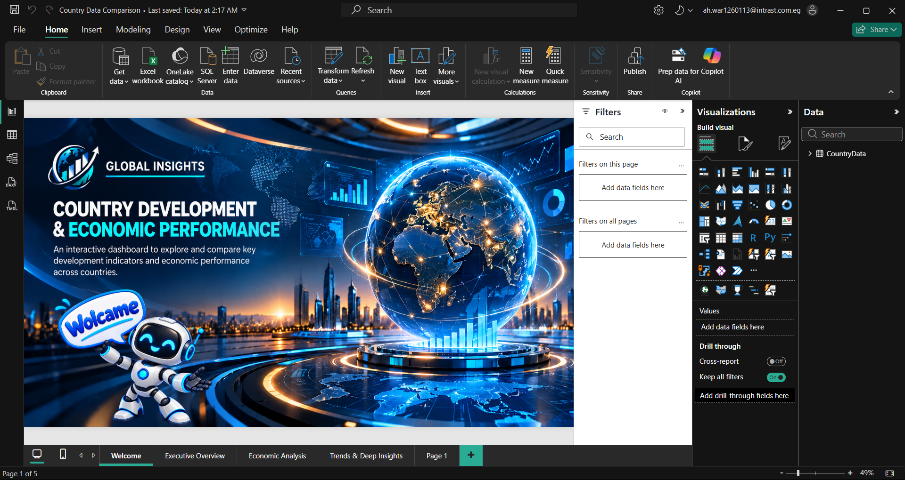
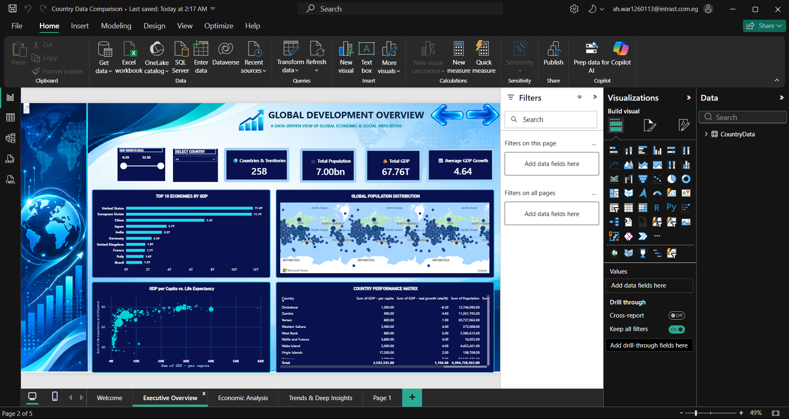
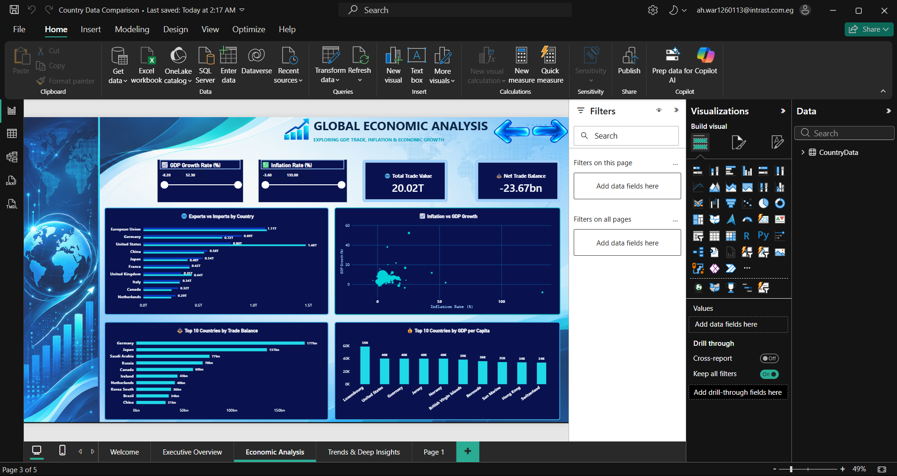
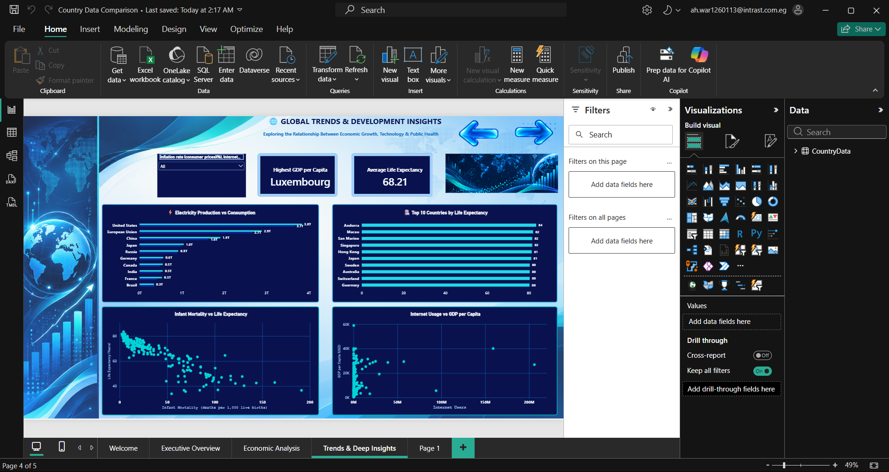
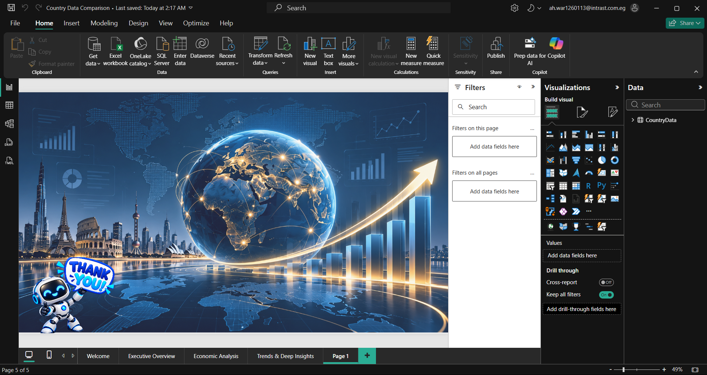

# 🌍 GLOBAL INSIGHTS
## Country Development & Economic Performance

An interactive Power BI dashboard exploring global economic performance and country development indicators.

---

## 📊 Dashboard Preview

### 🏠 1. Welcome Page

  

---

### 🌍 2. Executive Overview

  

This page provides a high-level overview of global development, including GDP, population, economic rankings, and country performance.

---

### 💹 3. Economic Analysis

  

Explore international trade, exports and imports, trade balances, inflation, GDP growth, and GDP per capita.

---

### 📈 4. Trends & Deep Insights

  

Analyze the relationships between life expectancy, infant mortality, internet usage, and electricity production.

---

### 🎉 5. Thank You Page

  

---

## 🛠️ Tools & Technologies

- Microsoft Power BI
- DAX
- Data Visualization
- Exploratory Data Analysis

---

## 🎯 Project Objectives

- Compare economic performance across countries.
- Identify the world's largest economies.
- Explore international trade patterns.
- Investigate relationships between inflation and economic growth.
- Analyze health and technology development indicators.
- Present data through interactive visualizations.

---

## 🚀 How to Use

1. Download `Country Data Comparison.pbix`.
2. Open the file in Microsoft Power BI Desktop.
3. Explore the dashboards and interactive filters.

---

## 👨‍💻 Author

Data Analytics Portfolio Project

**Built with Microsoft Power BI**
